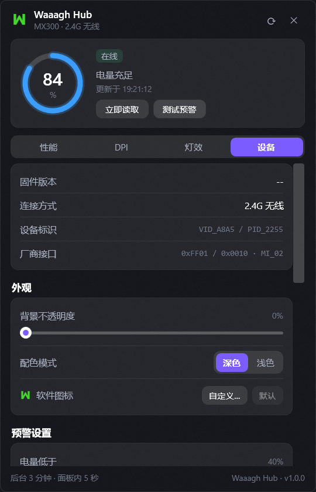
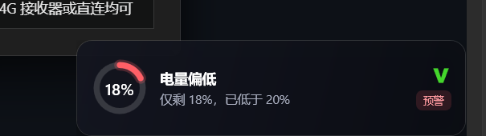

# Veloci Hub

名龙星球 MX300 无线鼠标的轻量本地控制台 —— 一个常驻托盘的小工具，直接通过原生 HID 报文读取电量、切换 DPI 档位，并在屏幕上弹出 OSD 提示。

| 面板 | OSD 提示 |
| --- | --- |
|  |  |

[](https://github.com/therehore/VelociHub/actions/workflows/build.yml)
[](LICENSE)
[](#环境要求)

> 非官方项目，与鼠标厂商无任何关联。详见[免责声明](#免责声明)。

<details>
<summary><b>English summary</b></summary>

**Veloci Hub** is a lightweight tray console for the MLOONG MX300 wireless mouse. It talks to the mouse directly over native HID reports — no vendor driver, no background service.

- **Battery & charging** — tray icon reflects level and charging state in real time
- **DPI switching** — one click in the panel; changes made with the physical DPI button sync back within a second
- **OSD** — gear changes, low battery, and charge-limit reminders fade in at a screen corner with an intro animation
- **Charge-limit guard** — nudges you to unplug at a configurable threshold (55%–95%) so the battery isn't parked at 100%
- **Appearance** — dark/light themes, 0–100 background opacity, custom software icon
- **Two-speed polling** — every 2 minutes in the background, 5 seconds while the panel is open or the tray icon is hovered

Shipped as a single self-contained executable: no .NET runtime to install, just unzip and run. Fully offline — no network calls, no telemetry.

*This is an unofficial project and is not affiliated with, endorsed by, or sponsored by the manufacturer. Product names and trademarks belong to their respective owners and are used only for descriptive, interoperability purposes. Provided "as is", without warranty of any kind.*

</details>

## 功能

- **电量与充电状态**：托盘图标实时反映电量，充电中 / 已充满单独标注
- **DPI 档位切换**：面板内一键切档；用鼠标实体 DPI 键切换后 1 秒内同步回面板
- **OSD 提示**：切档、低电量预警、充电上限提醒时在屏幕角落淡入淡出，带开场动画
- **充电上限保护**：达到设定阈值（55%–95%）时提醒取下充电线，保护电池
- **低电量预警**：两级阈值，可配置充电时是否也提醒
- **外观**：深色 / 浅色主题、背景不透明度 0–100、软件图标可换成自定义图片
- **两级轮询**：后台默认 2 分钟一次，面板打开或鼠标悬停时提速到 5 秒，兼顾实时性与功耗

## 下载

到 [Releases](https://github.com/therehore/VelociHub/releases) 下载 `VelociHub-win-x64.zip`，解压后双击 `VelociHub.exe` 即可 —— 自包含单文件，**不需要安装 .NET 运行时**。

首次运行 Windows 可能弹 SmartScreen 提示（未签名），点「更多信息 → 仍要运行」。

## 环境要求

| 项 | 要求 |
| --- | --- |
| 系统 | Windows 10 1809+ / Windows 11，x64 |
| 运行时 | 免安装（自包含打包）；源码构建需 [.NET 6 SDK](https://dotnet.microsoft.com/download/dotnet/6.0) |
| 设备 | 名龙星球 MX300（VID `0xA8A4`–`0xA8A7`），2.4G 接收器或直连均可 |

非 MX300 设备不会被识别，程序会一直显示「未连接」。

## 构建

```bash
git clone https://github.com/therehore/VelociHub.git
cd VelociHub
dotnet build -c Release
dotnet run -c Release
```

打包成免安装单文件（约 62 MB，含运行时）：

```bash
dotnet publish -c Release -r win-x64 --self-contained true \
  -p:PublishSingleFile=true \
  -p:EnableCompressionInSingleFile=true \
  -p:IncludeNativeLibrariesForSelfExtract=true \
  -p:DebugType=none \
  -o dist
```

## 使用

启动后只驻留托盘，左键单击或双击托盘图标打开面板；单击面板外任意位置收起。

**命令行参数**

| 参数 | 说明 |
| --- | --- |
| `--show` | 启动后立即展开面板 |
| `--osd` | 立刻弹一次 OSD（调试外观用） |
| `--logo <路径>` | 设置自定义软件图标 |
| `--logo default` | 恢复默认 V 标 |
| `--climit` | 弹一次充电上限提醒 |
| `--flip` | 弹一次翻页 / 模式切换提示 |

**本地文件位置**：`%APPDATA%\VelociHub\`

| 文件 | 说明 |
| --- | --- |
| `settings.json` | 全部设置项 |
| `brand.png` | 自定义图标（≤256px，选图时自动缩放转码） |
| `app.log` | 运行日志，超过 512 KB 自动重建 |

从旧版本升级时会自动迁移 `settings.json` 与 `brand.png`，无需手动搬。删掉这个目录即恢复出厂设置。

## 项目结构

```
├─ App.xaml(.cs)             应用入口、托盘联动、轮询节奏、命令行参数
├─ Hid/
│  ├─ HidDeviceFinder.cs     按 VID + 厂商控制集合定位设备
│  └─ HidChannel.cs          Overlapped 异步读写通道
├─ Protocol/Mx300Protocol.cs 报文编解码（电量、DPI、心跳、状态）
├─ Services/
│  ├─ DeviceService.cs       轮询调度、事件分发、状态缓存
│  ├─ AppSettings.cs         设置持久化与版本迁移
│  ├─ BrandIcon.cs           自定义图标载入 / 缩放 / 落盘
│  ├─ AppPaths.cs            本地目录约定 + 旧目录迁移
│  └─ TrayService.cs         托盘图标与右键菜单
├─ UI/
│  ├─ FlyoutWindow.xaml      主面板
│  ├─ OsdWindow.xaml         OSD 弹窗
│  ├─ Theme.xaml             控件样式与调色板
│  ├─ Backdrop.cs            亚克力背景
│  └─ Controls/              电量环、V 标（自绘控件）
└─ Native/NativeMethods.cs   Win32 / HID P-Invoke
```

零第三方依赖：只用 .NET 6 自带的 WPF / WinForms 和 Windows API。

## 实现说明

设备没有公开 SDK，报文格式通过抓包与逆向得到：

- 走 Windows 原生 HID（`hid.dll` + `kernel32`），不依赖厂商驱动，也不用装后台服务
- 厂商控制集合为 `UsagePage 0xFF01 / Usage 0x10`，输出报文长度 ≥ 8
- 异步读写全程使用非托管缓冲区（`Marshal.AllocHGlobal`），避免重叠 I/O 期间托管数组被移动导致堆损坏
- 鼠标实体 DPI 键**不主动上报报文**，档位靠心跳报文里的活跃档位字段 + 2500 ms 兜底回读同步

协议细节可能随固件版本变化。新版固件不兼容时，欢迎提 issue 并附上 `app.log`。

## 免责声明

- 本项目为个人非官方工具，**与名龙星球（及任何鼠标厂商）无隶属、授权或背书关系**。
- 程序仅通过本机 HID 接口读写鼠标状态，**不联网、不上传数据、不含遥测**。
- 报文格式来自可观察的 USB 流量逆向，可能触发厂商不认可的用法；由此产生的设备异常、保修问题等风险由使用者自行承担。
- 「MX300」及相关商标、名称归其各自权利人所有，本项目仅作技术交流。
- 代码按 MIT 协议提供，不附带任何担保。

## 作者

[@therehore](https://github.com/therehore)

## 许可证

[MIT](LICENSE) · 第三方组件声明见 [THIRD-PARTY-NOTICES.md](THIRD-PARTY-NOTICES.md)
